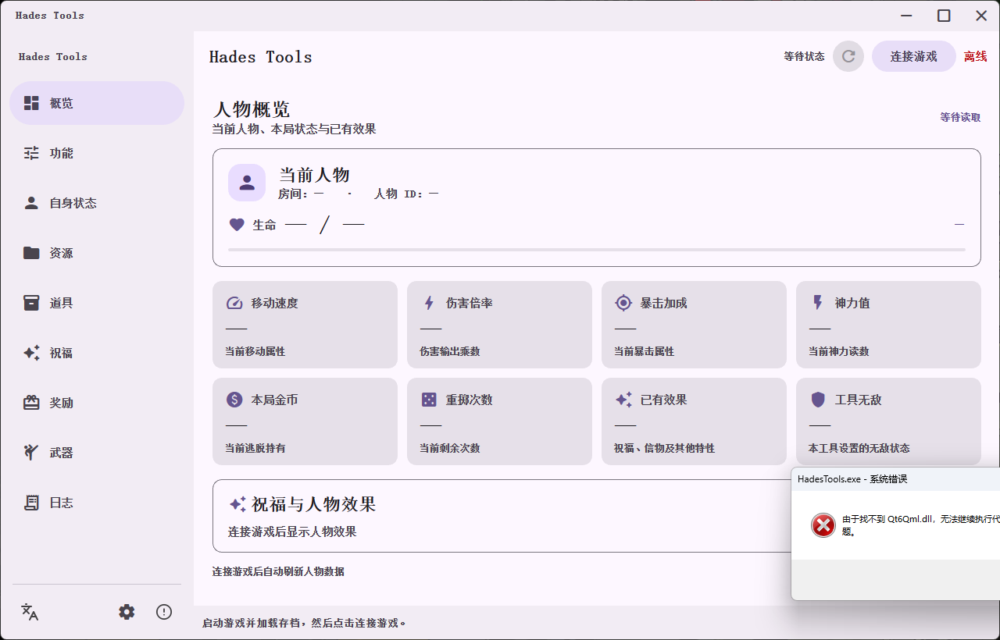
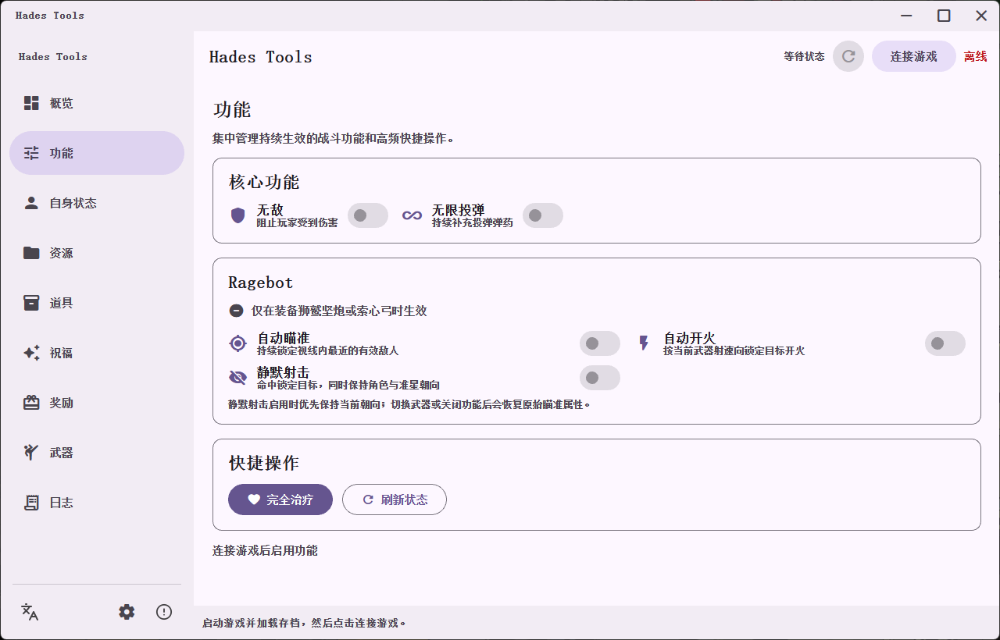

# Hades Tools

Hades Tools is a Windows x64 desktop trainer for the original Hades. The UI is implemented in C++17 and Qt 6, with a packaged Python/Frida bridge for game-side commands.



## Download

Open the repository's **Releases** page and download one of these assets:

- `HadesTools-v0.2.6-single.exe`: recommended one-file build. It extracts its bundled runtime under `%TEMP%` and starts the application.
- `HadesTools-v0.2.6-win64.zip`: portable directory build. Extract the whole archive before running `HadesTools.exe`.
- `HadesTools-v0.2.6-source.zip`: complete offline source package with the pinned UI dependency.

Verify downloads against `SHA256SUMS.txt` from the same release.

## Compatibility

- Windows x64
- Steam Hades build ID `10929685`
- `EngineWin64s.dll` SHA256: `4165a69c9ed8f48d9c839609011da55c12bbc877eb9b0550c4b099bd0524befd`

The bridge checks the supported engine entry bytes before applying the runtime profile. Other game builds require a matching profile.

## Features

- Core toggles including God Mode and 999 Cast ammunition.
- Ragebot for the Adamant Rail and Heart-Seeking Bow with target priority, fast switching, lock hold, auto aim, auto fire and silent projectile targeting.
- Perfect bow release timing, weapon synchronization and configurable spread behavior.
- Player state editing for health, dash count, speed, damage, critical chance, currency and rerolls.
- Current boon, rarity, level and weapon-upgrade inspection and editing.
- Searchable Chinese/English catalogs for resources, items, boons, rewards and weapons.
- Chinese and English UI, persistent theme settings, operation logs and responsive navigation.



## Run

1. Start Hades, load a save and enter gameplay.
2. Start Hades Tools.
3. Select **连接游戏**.
4. Close the game's pause menu before issuing commands because the game script thread pauses with it.

The application and bridge communicate only through `127.0.0.1:27864`.

## Build

Install Python 3.12 and Git, then run from PowerShell:

```powershell
cd native
.\install-environment.ps1
.\build.ps1
.\package.ps1
.\package-single.ps1
.\package-source.ps1
```

The scripts install or use Qt 6.8.3, MinGW 13.1.0, CMake, Ninja, PyInstaller and the pinned Python dependencies. Generated files are written under `native/dist`.

## Source Layout

- `native/src`: C++ application, backend and QML interface.
- `native/tools`: catalog tooling, package metadata and single-file launcher.
- `native/third_party`: pinned Material Components QML source.
- `analysis/hades_trainer`: the six runtime bridge sources and supported-build profile needed by PyInstaller.
- `.github/workflows`: Windows build and tag release automation.

Detailed runtime behavior and translation maintenance are documented in [`native/README.md`](native/README.md).

## License

Project-authored code is MIT licensed. Bundled dependencies retain their own terms; read [`THIRD_PARTY_NOTICES.md`](THIRD_PARTY_NOTICES.md) before redistribution. Hades is a trademark of Supergiant Games; this project is not affiliated with or endorsed by Supergiant Games.
